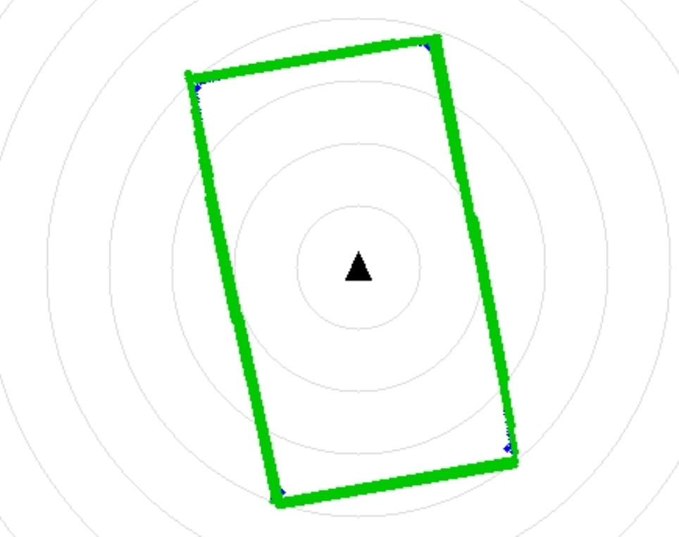
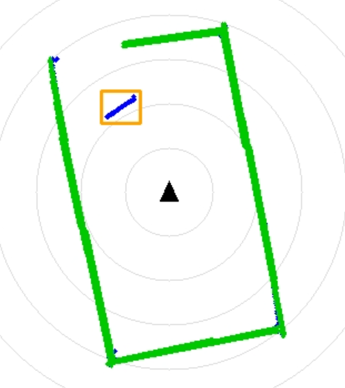
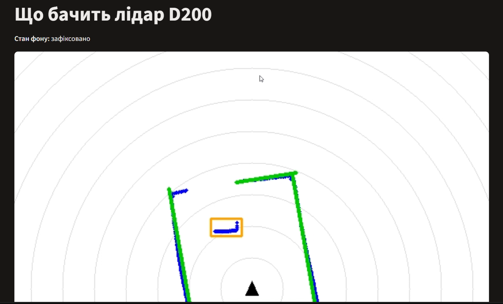
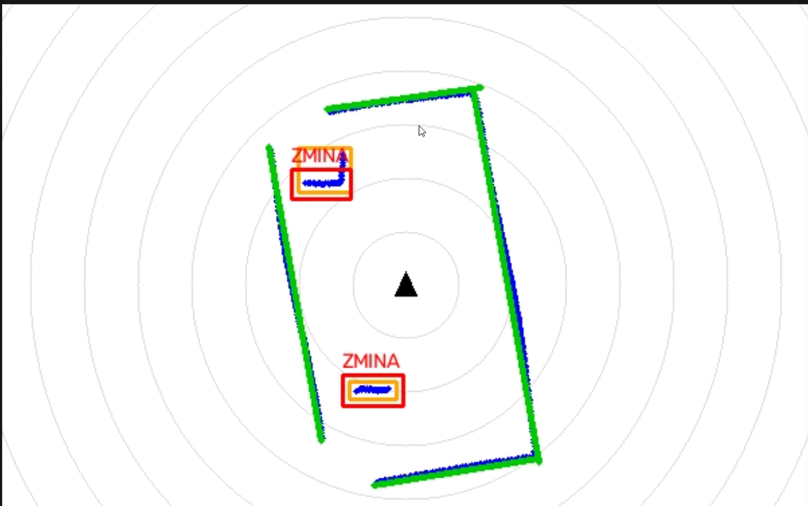

# Радарна система на базі лідара D200

Файл `scan.py` запускається як звичайний Python-скрипт і використовується виключно для запису сирих даних з лідара у форматі CSV. 
Файл `lidar.py` відповідає за живу візуалізацію даних і запускається в терміналі командою `streamlit run python/lidar.py`.

### Опис етапів розробки:

*   **Етап 1:** Налаштовано тестову сцену. Скрипт зчитує сирі байти з COM-порту та зберігає координати у CSV-файли для порожньої коробки та коробки з предметами.
*   **Етап 2:** Реалізовано багатопотокове (multithreading) читання даних, що дозволяє безперервно оновлювати зображення на екрані без затримок і зависань.
*   **Етап 3:** За допомогою морфологічних операцій та перетворення Гафа (`cv2.HoughLinesP`) програма розпізнає стіни коробки та виділяє їх зеленим кольором.
*   **Етап 4:** Використано алгоритм DBSCAN для кластеризації. Програма відрізняє шумові точки від реальних предметів, групує їх у кластери та обводить помаранчевими рамками.
*   **Етап 5:** Додано детектор змін. Програма фіксує еталонний фон сцени. Якщо відстань до об'єкта різко зменшується (перетинає поріг Z-оцінки), нова перешкода обводиться червоною рамкою з написом "ZMINA".
*   **Етап 6:** Створено повноцінний веб-застосунок на Streamlit з панеллю керування, живою легендою та лічильниками для тестування роботи всієї системи в реальному часі.

### Результати тестування (Етап 6)

| Дія (Що зробили фізично) | Що показав застосунок (Опис) | Знімок екрана |
| :--- | :--- | :--- |
| **1. Запустили застосунок із порожньою коробкою** | Застосунок відображає ідеальний прямокутний контур коробки. 4 стіни чітко виділені товстими зеленими лініями (Етап 3). Предметів 0, змін 0. Стан фону: «немає». |  |
| **2. Поставили 1 предмети в коробку** | Алгоритм DBSCAN успішно розпізнав перешкоди. Навколо одного предмета з'явилися акуратні помаранчеві рамки (Етап 4). Лічильник «Предметів (DBSCAN)» = 1. |  |
| **3. Натиснули «Зафіксувати сцену»** | Стан фону змінився на «Збираю X/10», а потім на «зафіксовано». Програма обчислила еталонну відстань до стін для кожного кута. |  |
| **4. Порухати/додати предмет в сцену щоб побачити зміни** | Відстань до перешкод змінилась. Навколо двох предметів миттєво з'явилися червоні рамки "ZMINA". Лічильник змін показав 2. |  |

**Тест на хибні тривоги:** 
За 30 секунд спостереження зафіксованої порожньої сцени не відбулося жодного хибного спрацювання (лічильник змін залишався на 0). Це доводить, що поріг $Z = -3$ обрано правильно.

**Чому прибраний предмет не позначається червоним:**
Застосунок шукає лише вторгнення (появу перешкод). Коли предмет з'являється, відстань стає меншою за фонову, Z-оцінка стає від'ємною і спрацьовує умова `Z < -3`. Якщо предмет прибрати, промінь летить далі до стіни, Z-оцінка стає додатною (наприклад, +5) і програма ігнорує зміну. Щоб реагувати на зникнення предметів, умову потрібно змінити на модуль: `abs((d_m - mu) / sigma) > abs(z_threshold)`.
